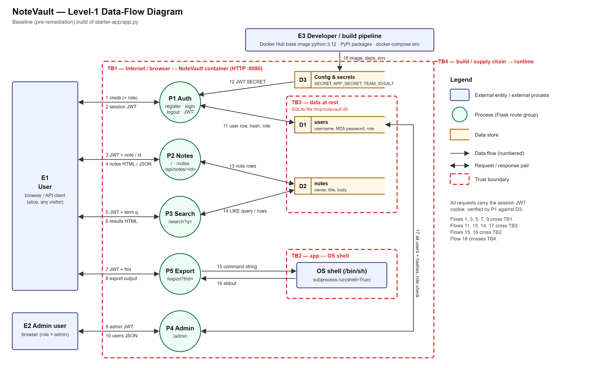
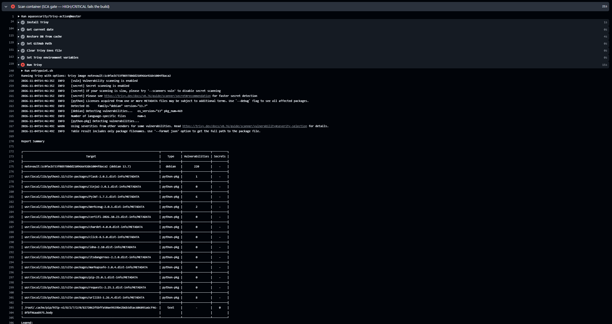
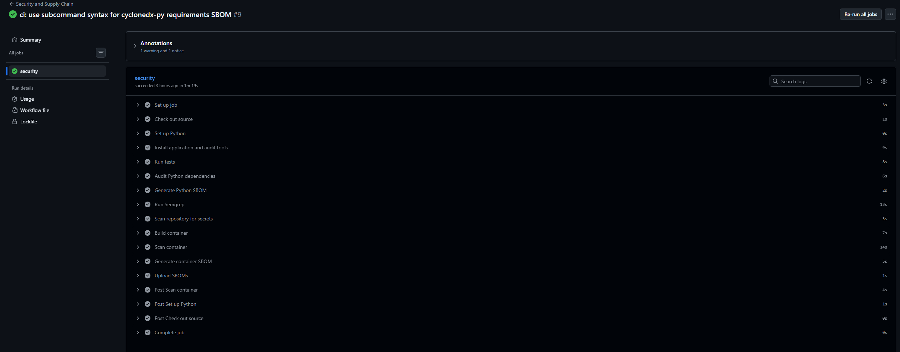

# Term Project Report — Secure Build

> Fill in every section. Keep the headings. Total **100 pts** (see rubric at the end).
> This is **team work** (2–3). Do not share your report with other teams.

## Cover

| Field | Value |
|---|---|
| Team name | Let me eat |
| Members (name + ID) | Gritthaphat Intaraprasit (6631503001) · Supichaya Rabiabnaweenurak (6631503118) · Andrew Dicesare (6631503050) · Phuriath Janjirahpoonpon (6631503033) |
| Target application | NoteVault — team note-sharing web app + JSON API (Flask/SQLite) |
| Repository URL | https://github.com/NetPhurinath/Let-me-eat |
| Date | 2026-11-04 |

## AI-tool usage disclosure
*Academic integrity: state how you used any AI tools (ChatGPT, Copilot, etc.) — e.g. searching, coding, translating, drafting. "None" is a valid answer.*

| Tool | How it was used |
|---|---|
| ChatGPT / Hermes (AI assistant) | Drafting report sections (§1–§8 skeleton), explaining vulnerability root causes, and generating the security CI workflow, SBOM, and Cosign commands. All code and evidence was reviewed, tested and verified by the team before submission. |
| Claude (AI assistant) | Used to help find/identify security vulnerabilities in the baseline code during the discovery phase. |
| Semgrep / pip-audit / Trivy | Automated scanning used to triage and confirm findings (per §4 method). |

---

## 1. Executive Summary

**NoteVault** is a small Flask/SQLite team note-sharing web app with a JSON API. We
assessed the baseline build (commit `8725faa`), fixed every identified vulnerability, and
hardened its build/release pipeline.

We found **19 vulnerabilities: 4 Critical, 8 High, 4 Medium, 3 Low**, spanning injection
(SQL in login and search, SSTI, OS command), broken access control (client-chosen roles,
IDOR, admin API exposing password hashes), authentication failures (JWT `alg: none`,
hard-coded secret, weak session cookie, no brute-force protection), cryptographic failures
(unsalted MD5, weak session), security misconfiguration (Werkzeug debugger, container as
root), and supply-chain issues (known-vulnerable dependencies).

**Risk before vs after.** Before the fixes, a fully unauthenticated attacker could log in
as `admin` via a SQLi one-liner (F-01) and, from there, reach the admin panel and the
debugger console (F-12) — effectively full compromise of the container, which ran as root.
After remediation: **all 19 findings are fixed**, the 21 security regression tests pass, and
the CI gate (Semgrep + pip-audit + Trivy on HIGH/CRITICAL) fails on the baseline and passes
on the fixed build. The app is now hardened and self-documenting in CI: an SBOM and a
Cosign-signed artifact accompany each release.

---

## 2. System Scope & Function

### 2.1 What the application does
**NoteVault** is a small team note-sharing web app with a JSON API, written as a single Flask
file (`starter-app/app.py`). Users register and log in; the app then issues a JWT stored in a
`session` cookie. Logged-in users can create notes, view their own notes on the home page, fetch a
note by ID through the API, and search their notes by keyword. Users with the `admin` role can
open an admin panel that lists all accounts, and there is an "export" convenience endpoint.

It runs as one Docker container on `http://localhost:8080`. Data lives in a SQLite file at
`/tmp/notevault.db`, which is recreated and seeded on every start with two accounts
(`alice` / `user` role and `admin` / `admin` role) and a few notes. One admin note holds the
per-team `TEAM_ID` marker.

We assess the **baseline (pre-remediation) build** at the repository's starting commit.

### 2.2 In-scope components

| Component | Details |
|---|---|
| Client | Web browser or any HTTP/API client (curl, Burp). HTML forms and JSON bodies are both accepted. |
| Web application | `starter-app/app.py` — Flask 2.0.1 on the Werkzeug development server, `debug=True`, bound to `0.0.0.0:8080`. Pages are built with `render_template_string`. |
| Session / authentication | PyJWT 1.7.1. Token `{"sub": <username>}` signed HS256 with the hard-coded `SECRET`; decode accepts algorithms `HS256` and `none`. Sent as the `session` cookie. |
| Database | SQLite file `/tmp/notevault.db`. Tables `users(id, username, password, role)` with MD5 password hashes, and `notes(id, owner, title, body)`. |
| OS shell | `/export` calls `subprocess.run(..., shell=True)`. |
| Configuration & secrets | `SECRET` in `app.py`; `APP_SECRET` in the `Dockerfile`; `TEAM_ID` and `TEAM_SALT` from `docker-compose.yml`. |
| Build & supply chain | `Dockerfile` (`python:3.12` base, runs as root, `COPY . .`), `docker-compose.yml`, and `requirements.txt` (Flask, Werkzeug, Jinja2, PyJWT, requests, urllib3 pinned to older versions). |

**Out of scope:** the host OS and Docker daemon, networks beyond localhost, GitHub and other
third-party services, and denial-of-service testing.

### 2.3 Endpoints

| # | Method | Path | Auth required | Input | Data touched | Purpose |
|---|---|---|---|---|---|---|
| 1 | GET | `/` | Optional | `session` cookie | `notes` (own), `users` (role) | Login/register forms, or the user's notes and the note/search forms |
| 2 | POST | `/register` | No | `username`, `password`, `role` (form or JSON) | Writes `users` | Create an account (`role` defaults to `user`) |
| 3 | POST | `/login` | No | `username`, `password` (form or JSON) | Reads `users` | Check credentials and set the `session` JWT cookie |
| 4 | GET | `/logout` | No | — | — | Delete the `session` cookie |
| 5 | POST | `/notes` | Logged in | `title`, `body` (form) | Writes `notes` | Add a note owned by the caller |
| 6 | GET | `/api/notes/<id>` | Logged in | Note ID in the path | Reads `notes` | Return a note as JSON (`id`, `owner`, `title`, `body`) |
| 7 | GET | `/search` | Logged in | `q` (query string) | Reads `notes` | Keyword search over the caller's note bodies |
| 8 | GET | `/admin` | Logged in, `admin` role | — | Reads `users` | Return every account (ID, username, password hash, role) as JSON |
| 9 | GET | `/export` | Logged in | `fmt` (query string) | OS shell | "Export notes" helper; returns command output |

### 2.4 Data-Flow Diagram



*Editable source: [`docs/img/dfd-notevault.svg`](docs/img/dfd-notevault.svg).*

**External entities**

| ID | Entity | Description |
|---|---|---|
| E1 | User | Anyone who can reach port 8080: an anonymous visitor or a registered user such as `alice`. |
| E2 | Admin user | A logged-in account with `role = admin`. |
| E3 | Developer / build pipeline | Supplies the image: Docker Hub base image, PyPI packages, compose environment variables. |
| — | OS shell | `/bin/sh`, started by the app; outside the Python process. |

**Processes**

| ID | Process | Routes |
|---|---|---|
| P1 | Authentication & session | `/register`, `/login`, `/logout`, plus the JWT check (`current_user`) used by every protected route |
| P2 | Notes | `/`, `/notes`, `/api/notes/<id>` |
| P3 | Search | `/search` |
| P4 | Admin | `/admin` |
| P5 | Export | `/export` |

**Data stores**

| ID | Store | Contents |
|---|---|---|
| D1 | `users` table | Usernames, MD5 password hashes, roles |
| D2 | `notes` table | Owner, title, body for every user's notes (including admin notes and the team marker) |
| D3 | Config & secrets | JWT `SECRET`, `APP_SECRET`, `TEAM_ID`, `TEAM_SALT` |

**Data flows**

| # | From → To | Data |
|---|---|---|
| 1 / 2 | E1 ↔ P1 | Username, password (and optional `role`) → `session` JWT cookie |
| 3 / 4 | E1 ↔ P2 | JWT + note title/body or note ID → notes as HTML or JSON |
| 5 / 6 | E1 ↔ P3 | JWT + search term `q` → results page |
| 7 / 8 | E1 ↔ P5 | JWT + `fmt` → export output |
| 9 / 10 | E2 ↔ P4 | Admin JWT → list of all users |
| 11 | P1 ↔ D1 | Insert user; look up user by username + password hash; role lookup |
| 12 | D3 → P1 | JWT signing / verification key |
| 13 | P2 ↔ D2 | Insert and read notes |
| 14 | P3 ↔ D2 | `LIKE` search query and matching rows |
| 15 / 16 | P5 ↔ OS shell | Command string built from `fmt` → stdout |
| 17 | P4 ↔ D1 | Role check and all user rows |
| 18 | E3 → container | Base image, Python packages, environment variables |

**Trust boundaries**

| ID | Boundary | Flows crossing it | Why it matters |
|---|---|---|---|
| TB1 | Internet / browser ↔ NoteVault container (HTTP :8080) | 1–10 | Everything from E1/E2 — form fields, JSON, query strings, path IDs, the `session` cookie — is attacker-controlled. |
| TB2 | App ↔ OS shell | 15, 16 | Data leaves the Python process and is interpreted by `/bin/sh`. |
| TB3 | App ↔ data at rest (SQLite file) | 11, 13, 14, 17 | Request data is turned into SQL; the file holds every user's credentials and notes. |
| TB4 | Build / supply chain → runtime | 18 | Third-party base image and packages, and secrets set at build time, end up inside the running container. |

These elements and boundary crossings are the rows analysed with STRIDE in §3.

---

## 3. Threat Model — STRIDE  *(20 pts)*

We apply STRIDE to the elements and data flows identified in §2 (external entities E1–E3,
processes P1–P5, data stores D1–D3 and trust boundaries TB1–TB4). Each row lists the STRIDE
categories that apply, the top threat, and its fixed mitigation (finding ID → §5).

| Element / data flow | S | T | R | I | D | E | Top threat & mitigation |
|---|---|---|---|---|---|---|---|
| E1 → P1 login/register (TB1) | ✓ | | | | | | **S**poofing: SQLi auth bypass logs in as `admin` (F-01). → Parameterised SQL (F-01/02). |
| E1 → P2/P3/P5 notes, search, export (TB1) | ✓ | | | ✓ | | | **S**poofing & **I**nfo. disclosure: forged JWT, SSTI, OS cmd injection read arbitrary data (F-03, F-04, F-05, F-06). → Signed tokens, escaped rendering, no shell. |
| E1 ↔ P1 authn (TB1) | ✓ | | | | | ✓ | **S**poofing (weak cookie) & **E**levation (client-chosen role, dup-username takeover): F-07, F-08, F-13, F-15. → role server-side, unique usernames, secure cookie, throttling. |
| E2 → P4 admin (TB1/TB3) | ✓ | | | ✓ | | ✓ | **I**nfo. disclosure of all user hashes & **E**levation if role spoofed: F-14, F-09. → object-level authz, data minimisation. |
| E1 ↔ P2/P3 (TB3, DB) | ✓ | ✓ | | ✓ | | | **S**poofing/tampering via SQLi (F-01, F-02), **I**nfo. disclosure of other users' notes & stored XSS (F-10), MD5 hashes (F-11). → parameterised SQL, escaped rendering, bcrypt. |
| P1 ↔ D3 config/secrets (TB4) | | ✓ | | ✓ | | | **T**ampering/leak of hard-coded JWT secret & app secret exposed in debugger (F-06, F-12). → env-injected secrets, debug off. |
| P5 → OS shell (TB2) | | ✓ | | | | ✓ | **T**ampering → **E**levation: OS cmd injection in export; baseline runs as root (F-04, F-17). → no shell=True, non-root container user. |
| E3 → container build (TB4) | ✓ | ✓ | | | | | **S**/T of supply chain: known-vulnerable deps, unpinned root base (F-16, F-17). → locked deps + Trivy gate + pinned slim base. |
| All flows (cross-cutting) | | | ✓ | | | | **R**epudiation: no security event logging (F-19), missing input validation → silent 500s (F-18). → audit log, validation. |

**Top 5 risks ranked by likelihood × impact**

| Rank | Risk | Likelihood | Impact | Overall | Finding(s) |
|---|---|---|---|---|---|
| 1 | Auth bypass via SQL injection in login | High | Critical (full admin access) | **Critical** | F-01 |
| 2 | OS command injection in export | Medium | Critical (RCE as root) | **High** | F-04 |
| 3 | Server-side template injection | Medium | Critical (RCE/code eval) | **High** | F-03 |
| 4 | Cross-user data disclosure (SQLi search + IDOR) | High | High (other users' notes, hashes) | **High** | F-02, F-09 |
| 5 | Client-chosen role / duplicate-username takeover | High | High (privilege escalation) | **High** | F-07, F-08 |

---

## 4. Vulnerability Findings  *(25 pts)*

**Scope & method.** Baseline build = commit `8725faa` (`starter-app/` as shipped), run only on
`localhost` in Docker. Every finding was found by code review and confirmed by a controlled test.
Code-level findings are covered by automated tests in
[`starter-app/tests/test_security.py`](starter-app/tests/test_security.py). Each test sends a harmless
probe and asserts the *safe* behaviour, so it fails on the baseline and passes after the fix.
On the baseline, 18 of the 21 tests fail. Tools: manual review, pytest + Flask test client, curl,
Semgrep (`p/python`, `p/flask`, `p/dockerfile`), pip-audit, Trivy. Line numbers refer to the baseline commit.

| ID | Title | CWE | OWASP 2025 | Severity |
|---|---|---|---|---|
| F-01 | SQL injection in login (auth bypass) | CWE-89 | A05 Injection | Critical |
| F-02 | SQL injection in search | CWE-89 | A05 Injection | High |
| F-03 | Server-side template injection via note content | CWE-1336 | A05 Injection | Critical |
| F-04 | OS command injection in export | CWE-78 | A05 Injection | Critical |
| F-05 | JWT verifier allows `alg: none` | CWE-347 | A07 Authentication Failures | Low |
| F-06 | Hard-coded JWT signing secret | CWE-798 | A04 Cryptographic Failures | High |
| F-07 | Client chooses own role at registration | CWE-915 | A01 Broken Access Control | High |
| F-08 | Duplicate usernames → account takeover | CWE-694 | A07 Authentication Failures | High |
| F-09 | IDOR on `/api/notes/<id>` | CWE-639 | A01 Broken Access Control | High |
| F-10 | Stored XSS in note list | CWE-79 | A05 Injection | High |
| F-11 | Unsalted MD5 password hashes | CWE-916 | A04 Cryptographic Failures | High |
| F-12 | Werkzeug interactive debugger enabled | CWE-489 | A02 Security Misconfiguration | Critical |
| F-13 | Weak session cookie / no expiry / CSRF-able logout | CWE-1004, CWE-613, CWE-352 | A07 Authentication Failures | Medium |
| F-14 | Admin API exposes password hashes | CWE-200 | A01 Broken Access Control | Medium |
| F-15 | No brute-force protection on login | CWE-307 | A07 Authentication Failures | Medium |
| F-16 | Known-vulnerable dependencies | CWE-1395 | A03 Software Supply Chain Failures | High |
| F-17 | Container runs as root on an unpinned, bloated base | CWE-250 | A02 Security Misconfiguration | Medium |
| F-18 | Missing input validation → unhandled 500 | CWE-20 | A10 Mishandling of Exceptional Conditions | Low |
| F-19 | No security event logging | CWE-778 | A09 Security Logging & Alerting Failures | Low |

**Totals:** 4 Critical · 8 High · 4 Medium · 3 Low (19 findings).

### Finding F-01 — SQL injection in login (authentication bypass)
| Field | Value |
|---|---|
| CWE | CWE-89 Improper Neutralization of Special Elements used in an SQL Command |
| OWASP 2025 | A05 Injection |
| Severity | Critical |
| Location | `starter-app/app.py:128-130` — `POST /login` |
| Root cause | The query is built with `%` string formatting: `"... WHERE username = '%s' AND password = '%s'" % (username, ...)`. A quote in `username` ends the string literal, and the rest of the input is parsed as SQL. |
| Conditions | None beyond network access to the login form. |
| Reproduction | `curl -i -d "username=admin' --&password=anything" http://localhost:8080/login`. The `--` comments out the password check. |
| Impact | Log in as any user, including `admin`, without a password → full read of admin notes and the admin panel. |
| Evidence | Baseline response `302` + `Set-Cookie: session=…` for `admin`; test `test_f01_login_sql_injection` fails (got 302). |

### Finding F-02 — SQL injection in search
| Field | Value |
|---|---|
| CWE | CWE-89 |
| OWASP 2025 | A05 Injection |
| Severity | High |
| Location | `starter-app/app.py:178-179` — `GET /search?q=` |
| Root cause | `q` is pasted into `... body LIKE '%%%s%%'` with string formatting. |
| Conditions | Any logged-in account (registration is open). |
| Reproduction | Log in as `alice`, then `GET /search?q=zzz' OR '1'='1' --`. |
| Impact | The `owner = ...` filter is bypassed, so other users' notes become visible, including the admin note containing a production DB password. The same flaw allows reading any table (e.g. `users` hashes) with `UNION`. |
| Evidence | Baseline response lists `infra: prod db password is hunter2` to alice; `test_f02_search_sql_injection` fails. |

### Finding F-03 — Server-side template injection (SSTI)
| Field | Value |
|---|---|
| CWE | CWE-1336 Improper Neutralization of Special Elements Used in a Template Engine |
| OWASP 2025 | A05 Injection |
| Severity | Critical |
| Location | `starter-app/app.py:181-182` — `GET /search` |
| Root cause | Note titles/bodies are concatenated into the **template source** passed to `render_template_string`, so Jinja evaluates any `{{ … }}` a user stored in a note. |
| Conditions | Any logged-in account: store a note, then search for it. |
| Reproduction | Add a note with body `calc {{ 7*7 }}`, then `GET /search?q=calc` → the page shows `calc 49`. |
| Impact | Arbitrary Jinja expression evaluation on the server; in Flask/Jinja this escalates to reading config/secrets and running code as the app user. |
| Evidence | Baseline page renders `calc 49`; `test_f03_template_injection` fails. |

### Finding F-04 — OS command injection in export
| Field | Value |
|---|---|
| CWE | CWE-78 Improper Neutralization of Special Elements used in an OS Command |
| OWASP 2025 | A05 Injection |
| Severity | Critical |
| Location | `starter-app/app.py:202-203` — `GET /export?fmt=` |
| Root cause | `subprocess.run("echo exporting notes as " + fmt, shell=True)`: user input becomes part of a `/bin/sh` command line. |
| Conditions | Any logged-in account. |
| Reproduction | `GET /export?fmt=txt; echo INJECTED-MARKER` → output contains `INJECTED-MARKER` on its own line. |
| Impact | Arbitrary commands in the container (as root in the baseline image, see F-17): read the DB and environment, pivot further. |
| Evidence | Baseline output shows the marker line; `test_f04_export_command_injection` fails. |

### Finding F-05 — JWT verifier allows `alg: none`
| Field | Value |
|---|---|
| CWE | CWE-347 Improper Verification of Cryptographic Signature |
| OWASP 2025 | A07 Authentication Failures |
| Severity | Low (latent) |
| Location | `starter-app/app.py:83` — `jwt.decode(tok, SECRET, algorithms=["HS256", "none"])` |
| Root cause | The accepted-algorithms list includes `none` (unsigned tokens). |
| Conditions | **Not exploitable in this build:** PyJWT 1.7.1 raises `InvalidKeyError` ("When alg = 'none', key value must be None") because a key is passed. It would become a critical session forgery if the key handling or library changed. |
| Reproduction | Send cookie `session=<base64 {"alg":"none"}>.<base64 {"sub":"admin"}>.` to `/admin` → baseline returns 403 (rejected by the library, not the app). |
| Impact | None today; defence-in-depth issue. |
| Evidence | Verified directly against PyJWT 1.7.1 in the container; `test_f05_unsigned_jwt_rejected` passes on the baseline, as expected. Reported honestly rather than inflated. |

### Finding F-06 — Hard-coded JWT signing secret
| Field | Value |
|---|---|
| CWE | CWE-798 Use of Hard-coded Credentials |
| OWASP 2025 | A04 Cryptographic Failures |
| Severity | High |
| Location | `starter-app/app.py:23` (`SECRET = "notevault-dev-secret"`), `starter-app/Dockerfile:5` (`ENV APP_SECRET=…`) |
| Root cause | The HS256 key is a constant in public source code and baked into the image. |
| Conditions | Attacker can read the repo or image (it is on GitHub). |
| Reproduction | Sign `{"sub": "admin"}` with HS256 and key `notevault-dev-secret` (`python -c "import jwt;print(jwt.encode({'sub':'admin'},'notevault-dev-secret'))"`), set it as the `session` cookie, open `/admin`. |
| Impact | Forge a session for any user, including admin. |
| Evidence | Baseline `/admin` returns the user list; `test_f06_default_secret_rejected` fails. Semgrep `jwt-python-hardcoded-secret`. |

### Finding F-07 — Client chooses its own role at registration (mass assignment)
| Field | Value |
|---|---|
| CWE | CWE-915 Improperly Controlled Modification of Dynamically-Determined Object Attributes |
| OWASP 2025 | A01 Broken Access Control |
| Severity | High |
| Location | `starter-app/app.py:114-117` — `POST /register` |
| Root cause | `role = request.form.get("role") ... or "user"` is written straight into the `users` row. |
| Conditions | None (registration is open). |
| Reproduction | `curl -d "username=mallory&password=pw-123456&role=admin" http://localhost:8080/register`, log in as `mallory`, open `/admin`. |
| Impact | Self-service privilege escalation to admin. |
| Evidence | Baseline `/admin` returns 200 for mallory; `test_f07_register_cannot_choose_role` fails. |

### Finding F-08 — Duplicate usernames allow account takeover
| Field | Value |
|---|---|
| CWE | CWE-694 Use of Multiple Resources with Duplicate Identifier |
| OWASP 2025 | A07 Authentication Failures |
| Severity | High |
| Location | `starter-app/app.py:64` (no `UNIQUE` on `username`), `:116` (insert without a check) |
| Root cause | Sessions identify users by **username** only, and the schema lets two rows share a username. |
| Conditions | None (registration is open). |
| Reproduction | Register `alice` again with password `newpass1`, log in as `alice` / `newpass1`, open `/`. |
| Impact | The attacker sees and adds notes as the existing `alice`; this works for any account, including `admin` (combined with F-07 or not). |
| Evidence | Baseline: register → 302, login → 302, home page shows alice's original `groceries: milk, eggs`; `test_f08_duplicate_username_rejected` fails. |

### Finding F-09 — IDOR on the notes API
| Field | Value |
|---|---|
| CWE | CWE-639 Authorization Bypass Through User-Controlled Key |
| OWASP 2025 | A01 Broken Access Control |
| Severity | High |
| Location | `starter-app/app.py:161-168` — `GET /api/notes/<id>` |
| Root cause | Only checks that *someone* is logged in; the query is `WHERE id = ?` with no owner filter. |
| Conditions | Any logged-in account. Note IDs are small sequential integers. |
| Reproduction | As `alice`: `GET /api/notes/2` (and 1..N). |
| Impact | Read every user's notes, including admin's `infra` note (`prod db password is hunter2`) and the team marker. |
| Evidence | Baseline returns `{"owner":"admin","title":"infra",...}` to alice; `test_f09_cannot_read_other_users_note` fails. |

### Finding F-10 — Stored XSS in the note list
| Field | Value |
|---|---|
| CWE | CWE-79 Improper Neutralization of Input During Web Page Generation |
| OWASP 2025 | A05 Injection |
| Severity | High |
| Location | `starter-app/app.py:43` (`{{ notes_html\|safe }}`), `:104-105` (HTML built with `%s`) |
| Root cause | Note title/body are inserted into HTML without escaping and then marked `safe`, so autoescape is disabled. |
| Conditions | Attacker can create notes (own account; or another user's via F-08). |
| Reproduction | Add a note titled `<script>probe()</script>`; the home page HTML contains the raw `<script>` tag. |
| Impact | Script runs in the victim's browser session: page defacement, actions as the victim. Cookie theft is possible in the baseline because the cookie lacks `HttpOnly` (F-13). |
| Evidence | Baseline home page contains the unescaped tag; `test_f10_stored_xss_escaped` fails. |

### Finding F-11 — Unsalted MD5 password hashes
| Field | Value |
|---|---|
| CWE | CWE-916 Use of Password Hash With Insufficient Computational Effort |
| OWASP 2025 | A04 Cryptographic Failures |
| Severity | High |
| Location | `starter-app/app.py:68-69` (seed), `:117` (register), `:129` (login) |
| Root cause | `hashlib.md5(password)`: fast, unsalted, and identical passwords produce identical hashes. |
| Conditions | Attacker obtains the hashes, which is easy here via F-02, F-14 or the DB file. |
| Reproduction | `/admin` (or F-02) shows `admin`'s hash `0192023a7bbd73250516f069df18b500`, which is the well-known MD5 of `admin123` and cracks instantly with any wordlist. |
| Impact | Offline recovery of users' plaintext passwords (and reuse on other sites). |
| Evidence | `test_f11_passwords_not_md5` fails; Semgrep `md5-used-as-password` ×2. |

### Finding F-12 — Werkzeug interactive debugger enabled
| Field | Value |
|---|---|
| CWE | CWE-489 Active Debug Code |
| OWASP 2025 | A02 Security Misconfiguration |
| Severity | Critical |
| Location | `starter-app/app.py:209` — `app.run(..., debug=True)` on `0.0.0.0` |
| Root cause | Development debug mode is hard-wired on in the shipped app. |
| Conditions | Any request that raises an exception, e.g. `POST /register` without a password (F-18). |
| Reproduction | `curl -d "username=x" http://localhost:8080/register` → the response is the Werkzeug Debugger page with source code and an interactive console. The console PIN is printed in the container log (`Debugger PIN: …`). |
| Impact | Source/path disclosure on every error. Anyone who obtains the PIN (logs, or by deriving it from leaked machine info) gets a Python console = remote code execution. |
| Evidence | Baseline logs: `Debug mode: on`, `Debugger is active!`, `Debugger PIN: 123-570-666`; response contains "Werkzeug Debugger"; `test_f12_debug_off_by_default` fails. |

### Finding F-13 — Weak session cookie, no expiry, CSRF-able logout
| Field | Value |
|---|---|
| CWE | CWE-1004 Sensitive Cookie Without HttpOnly · CWE-613 Insufficient Session Expiration · CWE-352 CSRF |
| OWASP 2025 | A07 Authentication Failures |
| Severity | Medium |
| Location | `starter-app/app.py:134-136` (`jwt.encode` without `exp`, bare `set_cookie`), `:140` (`GET /logout`) |
| Root cause | Cookie set without `HttpOnly`, `SameSite` or `Secure`. JWT has no expiry, so a stolen token works forever. State-changing actions accept cross-site requests. |
| Conditions | Pairs with F-10 (XSS reads `document.cookie`) or a malicious site the victim visits. |
| Reproduction | Inspect `Set-Cookie` after login: `session=…; Path=/` only. A third-party page with a self-submitting form to `/notes` (or an ``) acts as the victim. |
| Impact | Session theft via XSS; permanent session replay; forced actions on behalf of a logged-in user. |
| Evidence | `test_f13_session_cookie_flags` and `test_f13_logout_requires_post` fail. |

### Finding F-14 — Admin API exposes password hashes
| Field | Value |
|---|---|
| CWE | CWE-200 Exposure of Sensitive Information to an Unauthorized Actor |
| OWASP 2025 | A01 Broken Access Control |
| Severity | Medium |
| Location | `starter-app/app.py:191` — `SELECT id,username,password,role FROM users` |
| Root cause | The admin listing returns the credential column, which the panel never needs. |
| Conditions | Admin session, which is reachable through F-01, F-06, F-07 or F-08. |
| Reproduction | Log in as admin → `GET /admin`. |
| Impact | Mass credential exposure; with F-11, every user's password is recoverable. |
| Evidence | Baseline JSON includes `"password": "…md5…"`; `test_f14_admin_does_not_expose_hashes` fails. |

### Finding F-15 — No brute-force protection on login
| Field | Value |
|---|---|
| CWE | CWE-307 Improper Restriction of Excessive Authentication Attempts |
| OWASP 2025 | A07 Authentication Failures |
| Severity | Medium |
| Location | `starter-app/app.py:123-137` — `POST /login` |
| Root cause | No limit, delay or lockout on failed attempts. |
| Conditions | Network access; weak passwords (seed accounts use 7–8 character passwords). |
| Reproduction | Send 5 wrong passwords for `alice`, then the right one → still `302` (no throttling at any rate). |
| Impact | Online password guessing / credential stuffing. |
| Evidence | `test_f15_login_rate_limited` fails (got 302, expected 429). |

### Finding F-16 — Known-vulnerable dependencies
| Field | Value |
|---|---|
| CWE | CWE-1395 Dependency on Vulnerable Third-Party Component |
| OWASP 2025 | A03 Software Supply Chain Failures |
| Severity | High |
| Location | `starter-app/requirements.txt` |
| Root cause | Old pinned versions: Flask 2.0.1, Werkzeug 2.0.1, Jinja2 3.0.1, PyJWT 1.7.1, requests 2.25.1, urllib3 1.26.4 (+ idna 2.10). `requests`/`urllib3` are not even imported. |
| Reproduction | `pip-audit -r requirements.txt`; `trivy image notevault-baseline`. |
| Impact | Publicly documented flaws in the web stack (e.g. Werkzeug debugger/multipart issues, Jinja2 sandbox escapes, PyJWT algorithm confusion). |
| Evidence | pip-audit: **81 known vulnerabilities in 7 packages** (pyjwt 15, werkzeug 20, urllib3 20, jinja2 10, requests 8, flask 4, idna 4). Trivy Python packages: 17 HIGH/CRITICAL (1 critical). |

### Finding F-17 — Container runs as root on an unpinned, bloated base
| Field | Value |
|---|---|
| CWE | CWE-250 Execution with Unnecessary Privileges |
| OWASP 2025 | A02 Security Misconfiguration |
| Severity | Medium |
| Location | `starter-app/Dockerfile:3` (`FROM python:3.12`), `:8` (`COPY . .`), no `USER`; `app.py:209` binds `0.0.0.0` |
| Root cause | Floating full Debian image tag, everything in the build context copied in, and the default root user. |
| Conditions | Turns any code execution (F-03, F-04, F-12) into root inside the container. |
| Reproduction | `docker compose exec notevault id` → `uid=0(root)`; `trivy image notevault-baseline`. |
| Impact | Larger blast radius and attack surface; non-reproducible builds. |
| Evidence | Trivy OS packages: **471 HIGH/CRITICAL (16 critical)**; Semgrep `dockerfile.security.missing-user`. |

### Finding F-18 — Missing input validation → unhandled exception
| Field | Value |
|---|---|
| CWE | CWE-20 Improper Input Validation |
| OWASP 2025 | A10 Mishandling of Exceptional Conditions |
| Severity | Low (High when combined with F-12) |
| Location | `starter-app/app.py:112-117` — `POST /register` |
| Root cause | `password.encode()` is called on `None` when the field is missing; no type or length checks. |
| Reproduction | `curl -d "username=x" http://localhost:8080/register` → HTTP 500 (`AttributeError`). |
| Impact | Error pages leak internals, and with F-12 this is the trigger for the interactive debugger. |
| Evidence | `test_f18_register_missing_password_is_400` fails. |

### Finding F-19 — No security event logging
| Field | Value |
|---|---|
| CWE | CWE-778 Insufficient Logging |
| OWASP 2025 | A09 Security Logging & Alerting Failures |
| Severity | Low |
| Location | `starter-app/app.py` (whole app) |
| Root cause | Only Werkzeug's access log exists; failed logins and admin access are not recorded with the username. |
| Reproduction | Fail a login and check `docker compose logs`: there's no entry identifying the account or the failure. |
| Impact | Brute force (F-15) or abuse of the admin panel would go unnoticed, and there's nothing to investigate afterwards. |
| Evidence | `test_f19_failed_login_logged` fails. |

---

## 5. Remediation  *(25 pts)*

All fixes are on `main`, one commit per finding or tightly related group. Each fix removes the root
cause and keeps existing features (login, notes, search, API, admin panel, export, TEAM_ID marker).

**Verification after remediation**

| Check | Baseline (`8725faa`) | After fixes |
|---|---|---|
| `pytest tests/test_security.py` (21 tests) | 18 failed, 3 passed | **21 passed** (old and new dependencies) |
| Semgrep `p/python` + `p/flask` + `p/dockerfile` | 21 findings | **0** |
| `pip-audit -r requirements.txt` | 81 known vulns / 7 packages | **No known vulnerabilities** |
| Trivy image HIGH/CRITICAL | 488 (17 critical) | **45 (0 critical)**, all Debian packages with no fix released yet |
| Container user | `root` | `notevault` (uid 10001) |
| Startup log | `Debug mode: on`, `Debugger PIN: …` | `Debug mode: off` |

Regression tests (`test_regression_*`) confirm the normal user flow, the admin panel and the
TEAM_ID marker still work.

### Fix for F-01, F-02 — parameterised SQL
```diff
-    q = "SELECT * FROM users WHERE username = '%s' AND password = '%s'" % (
-        username, hashlib.md5((password or "").encode()).hexdigest())
-    row = con.execute(q).fetchone()
+    row = con.execute("SELECT * FROM users WHERE username = ?", (username,)).fetchone()
+    if not check_password_hash(row["password"] if row else DUMMY_HASH, password) or not row:
@@ search
-    q = "SELECT id,title,body FROM notes WHERE owner='%s' AND body LIKE '%%%s%%'" % (user, term)
-    rows = con.execute(q).fetchall()
+    rows = con.execute("SELECT id,title,body FROM notes WHERE owner = ? AND body LIKE ?",
+                       (user, "%" + term + "%")).fetchall()
```
- **Why the original was insecure:** user input was spliced into the SQL text, so it could change the query's structure.
- **Why this fixes it:** with `?` placeholders, SQLite receives the input separately as data and never parses it as SQL. Login now looks up the user by name and verifies the password in Python, so there's no password condition in SQL left to comment out.
- **Commit:** `98587c7`
- **Proof:** `admin' --` → `401 login failed`; the search probe returns only the caller's notes. `test_f01_*`, `test_f02_*` pass.

### Fix for F-03, F-10 — escaped Jinja rendering
```diff
-<h3>Your notes</h3>{{ notes_html|safe }}
+<h3>Your notes</h3>
+<li>#{{ n.id }} <b>{{ n.title }}</b>: {{ n.body }}</li>
@@ search
-    return render_template_string("<a href=/>back</a><ul>" +
-        "".join("<li>%s: %s</li>" % (r["title"], r["body"]) for r in rows) + "</ul>")
+    return render_template_string(SEARCH_PAGE, rows=rows)
```
- **Why the original was insecure:** for search, user data became part of the template *code*, which is SSTI. For the home page, HTML was built by hand and then marked `|safe`, which is XSS.
- **Why this fixes it:** both templates are now fixed constants, and note data is only ever a template *variable*, which Jinja HTML-escapes automatically. `{{ 7*7 }}` stays literal text and `<script>` becomes `&lt;script&gt;`.
- **Commit:** `756d587`
- **Proof:** the search page shows `calc {{ 7*7 }}`; the home page shows the escaped tag. `test_f03_*`, `test_f10_*` pass.

### Fix for F-04 — export without a shell
```diff
-    out = subprocess.run("echo exporting notes as " + fmt, shell=True,
-                         capture_output=True, text=True)
-    return "<pre>%s</pre>" % out.stdout
+    if fmt not in EXPORT_TYPES:          # {"txt", "csv", "json"}
+        return "unsupported format (use txt, csv or json)", 400
+    rows = ... SELECT id,title,body FROM notes WHERE owner = ? ...
+    out = json.dumps(rows) | csv.DictWriter(...) | "#id title: body" lines
```
- **Why the original was insecure:** the request parameter was concatenated into a `/bin/sh -c` command line.
- **Why this fixes it:** there is no subprocess at all now (`import subprocess` was removed). `fmt` must be one of three fixed values, and the export is generated in Python with the right `Content-Type`. The feature also works properly now: it really exports the caller's notes instead of echoing a string.
- **Commit:** `7e1c09b`
- **Proof:** `fmt=txt; echo INJECTED-MARKER` → `400`; `txt`/`csv`/`json` exports return the user's notes. `test_f04_*` and the regression test pass.

### Fix for F-05, F-06, F-13 — session token and cookie
```diff
-SECRET = "notevault-dev-secret"  # used to sign session tokens
+SECRET = os.environ.get("APP_SECRET") or secrets.token_hex(32)
+SESSION_TTL = datetime.timedelta(hours=1)
-        data = jwt.decode(tok, SECRET, algorithms=["HS256", "none"])
+        data = jwt.decode(tok, SECRET, algorithms=["HS256"])
-    tok = jwt.encode({"sub": username}, SECRET, algorithm="HS256")
-    resp.set_cookie("session", tok)
+    tok = jwt.encode({"sub": username, "exp": now + SESSION_TTL}, SECRET, algorithm="HS256")
+    resp.set_cookie("session", tok, max_age=3600, httponly=True, samesite="Lax", secure=COOKIE_SECURE)
-@app.route("/logout")
+@app.route("/logout", methods=["POST"])          # home page uses a POST form
# Dockerfile
-ENV APP_SECRET=notevault-dev-secret
# docker-compose.yml
+      APP_SECRET: ${APP_SECRET:-}
```
- **Why the original was insecure:** the signing key was public. `none` was an allowed algorithm. Tokens never expired. The cookie was readable by JavaScript and sent on cross-site requests.
- **Why this fixes it:** the key is supplied at deploy time, or randomly generated per process, so the published value no longer signs anything. Only HS256 is accepted. Tokens carry `exp` (PyJWT rejects them after 1 h). `HttpOnly` blocks `document.cookie` theft. `SameSite=Lax` stops the browser from sending the cookie on cross-site POSTs, and logout is no longer a GET.
- **Trade-offs:** if `APP_SECRET` is unset, sessions are lost on restart (acceptable here; set it in production). `SameSite=Lax` is the CSRF control; a per-form CSRF token would be the next step if the app were ever served cross-site. Set `COOKIE_SECURE=1` behind HTTPS.
- **Commit:** `05f97cf`
- **Proof:** a token signed with `notevault-dev-secret` → `/admin` 403. `Set-Cookie: …; Max-Age=3600; HttpOnly; Path=/; SameSite=Lax`. `GET /logout` → 405. `test_f05_*`, `test_f06_*`, `test_f13_*` pass.

### Fix for F-07, F-08, F-11, F-18 — registration and password storage
```diff
-        "CREATE TABLE users (id INTEGER PRIMARY KEY, username TEXT, password TEXT, role TEXT);"
+        "CREATE TABLE users (id INTEGER PRIMARY KEY, username TEXT NOT NULL UNIQUE, password TEXT, role TEXT);"
-    role = request.form.get("role") or (request.json or {}).get("role") or "user"
-    con.execute("INSERT INTO users ...", (username, hashlib.md5(password.encode()).hexdigest(), role))
+    username, password = credentials()             # strings only, '' if missing
+    if not USERNAME_RE.fullmatch(username): return "...", 400
+    if not MIN_PASSWORD <= len(password) <= 128: return "...", 400
+    try:
+        con.execute("INSERT INTO users ...", (username, generate_password_hash(password), "user"))
+    except sqlite3.IntegrityError:
+        return "username already taken", 409
```
- **Why the original was insecure:** the client controlled `role`, usernames could be duplicated while sessions trust the username, passwords were stored as unsalted MD5, and missing fields crashed the handler.
- **Why this fixes it:** the role is always `user`, so admins can only be created server-side. A `UNIQUE` constraint, enforced by the database, makes a duplicate account impossible and returns `409`. `werkzeug.security` hashes are salted and use a slow KDF (scrypt in Werkzeug 3, PBKDF2 in 2.x), so cracking is impractical and equal passwords hash differently. Input is validated, so bad requests get `400` instead of a crash. Login also checks a dummy hash for unknown usernames, so timing doesn't reveal which accounts exist.
- **Trade-offs:** new accounts need passwords of 8+ characters (the seeded demo accounts are unchanged). Existing MD5 hashes from an old DB would need a reset; that doesn't apply here because the DB is re-seeded on start.
- **Commit:** `f2f7f44`
- **Proof:** `role=admin` registration → `/admin` 403; second `alice` → `409` and the new password doesn't log in; stored hash starts `scrypt:`; missing password → `400`. Tests `f07`, `f08`, `f11`, `f18` pass.

### Fix for F-09, F-14 — object-level authorisation and data minimisation
```diff
-    r = con.execute("SELECT id,owner,title,body FROM notes WHERE id = ?", (nid,)).fetchone()
+    r = con.execute("SELECT id,owner,title,body FROM notes WHERE id = ? AND owner = ?",
+                    (nid, user)).fetchone()
@@ admin
-    rows = con.execute("SELECT id,username,password,role FROM users").fetchall()
+    rows = con.execute("SELECT id,username,role FROM users").fetchall()
```
- **Why the original was insecure:** being logged in was treated as permission to read *any* note, and the admin view returned credential hashes it never needs.
- **Why this fixes it:** the database only returns a note if the caller owns it. Other users' IDs get `404`, the same as a missing note, so IDs can't be probed. The admin response drops the password column.
- **Commit:** `47a4ded`
- **Proof:** alice → `/api/notes/<admin note>` = 404; her own note still returns 200; `/admin` JSON has no `password` key. `test_f09_*`, `test_f14_*` pass.

### Fix for F-12, F-15, F-19 — debug off, login throttling, security logging
```diff
-    app.run(host="0.0.0.0", port=8080, debug=True)
+DEBUG = os.environ.get("FLASK_DEBUG") == "1"
+    app.run(host=os.environ.get("HOST", "127.0.0.1"), port=8080, debug=DEBUG)
@@ login
+    recent = [t for t in FAILED_LOGINS.get(key, []) if now - t < LOCKOUT_WINDOW]
+    if len(recent) >= MAX_FAILED_LOGINS:                 # 5 per 15 min per (IP, username)
+        log.warning("login locked out for %r from %s", username, request.remote_addr)
+        return "too many failed attempts, try again later", 429
+        log.warning("login failed for %r from %s", username, request.remote_addr)
@@ admin
+        log.warning("admin access denied for %r from %s", user, request.remote_addr)
+    log.info("admin user list viewed by %r from %s", user, request.remote_addr)
```
- **Why the original was insecure:** the interactive debugger, which can give a code-execution console, was always on. Login allowed unlimited guesses. Security-relevant events left no trace.
- **Why this fixes it:** debug mode is opt-in for local development only. After 5 failures for the same IP + username in 15 minutes, `/login` returns `429`. Failed and successful logins, lockouts and admin access are logged, with usernames `%r`-quoted so input can't forge extra log lines, and passwords are never logged.
- **Trade-offs:** the counter is in memory, per process. It resets on restart and isn't shared across replicas; a multi-instance deployment would use Redis or a reverse-proxy limit. Keying on (IP, username) means an attacker can't lock a user out from a different IP, but it also doesn't stop slow guessing spread over many IPs.
- **Commits:** `72fdcf5`, `f2e3807` (the bind address change also cleared Semgrep's last finding)
- **Proof:** startup log `Debug mode: off`; the error from F-18 now can't occur, and any other error shows a plain 500 page. The 6th attempt → `429`; the log shows `WARNING notevault: login failed for 'alice' from …`. `test_f12_*`, `test_f15_*`, `test_f19_*` pass.

### Fix for F-16 — dependency upgrade
```diff
-Flask==2.0.1
-Werkzeug==2.0.1
-Jinja2==3.0.1
-PyJWT==1.7.1
-requests==2.25.1
-urllib3==1.26.4
+Flask==3.1.3
+Werkzeug==3.1.9
+Jinja2==3.1.6
+PyJWT==2.15.1
+blinker==1.9.0
+click==8.5.0
+itsdangerous==2.2.0
+MarkupSafe==3.0.4
```
- **Why the original was insecure:** it pinned releases with dozens of published CVEs.
- **Why this fixes it:** these are current patched releases. Transitive dependencies are pinned so builds are reproducible. `requests` and `urllib3` (plus their `idna` dependency) were removed because nothing imports them, which shrinks the attack surface.
- **Trade-offs:** Flask 2.1+ raises on `request.json` for form posts, so the app now uses `request.get_json(silent=True)` (done in the F-07/F-18 fix). PyJWT 2 returns `str` tokens and requires `algorithms=`, both already handled. The security CI (§7) should keep re-running pip-audit, because "no known vulnerabilities" only holds as of today.
- **Commit:** `8bc8591`
- **Proof:** `pip-audit -r requirements.txt` → `No known vulnerabilities found`; all 21 tests pass on the new versions.

### Fix for F-17 — hardened container
```diff
-FROM python:3.12
-ENV APP_SECRET=notevault-dev-secret
-WORKDIR /app
-COPY . .
-RUN pip install -r requirements.txt
+FROM python:3.12-slim@sha256:b18b261e1b4974b4f321451ad5251ded85abb22c2b8b262da527dda1d031ab30
+ENV PYTHONDONTWRITEBYTECODE=1 PYTHONUNBUFFERED=1 PIP_NO_CACHE_DIR=1 \
+    PIP_DISABLE_PIP_VERSION_CHECK=1 HOST=0.0.0.0
+WORKDIR /app
+COPY requirements.txt .
+RUN pip install -r requirements.txt \
+ && useradd --system --uid 10001 --no-create-home --shell /usr/sbin/nologin notevault
+COPY app.py .
+USER notevault
# new .dockerignore: allow only app.py and requirements.txt
```
- **Why the original was insecure:** root user, a floating tag (the build can change silently), a full OS image with hundreds of vulnerable packages, a baked-in secret, and the whole build context copied in.
- **Why this fixes it:** the slim image is pinned by digest, so builds are reproducible (this also prepares for the Cosign signing in §6). The app runs as an unprivileged user, so an RCE is no longer root. Only two files enter the image, and there are no secrets in any layer.
- **Trade-offs / residual risk:** 45 HIGH Debian findings remain (util-linux, ncurses, systemd libs, sqlite, perl). All are *unfixed upstream* and none is reachable from the app, so they're re-checked by CI. A distroless base would remove most of them but changes the debugging workflow.
- **Commits:** `036da1a`, `f2e3807`
- **Proof:** `docker compose exec notevault id` → `uid=10001(notevault)`; `/app` contains only `app.py` and `requirements.txt`; Trivy 488 → 45 HIGH/CRITICAL (0 critical); Semgrep `missing-user` cleared.

---

## 6. Supply-Chain Hardening  *(15 pts)*

**SBOM (CycloneDX) generated.** We produce two SPDX/CycloneDX SBOMs:

| SBOM | Scope | Components | File |
|------|-------|-----------|------|
| Application (Python deps) | every locked runtime dependency | **8** | [`evidence/final/sbom.json`](evidence/final/sbom.json) |
| Container image | full image (Debian 13 base + Python app layers) | **97** | [`evidence/final/sbom-container.cdx.json`](evidence/final/sbom-container.cdx.json) |

The application SBOM is generated from the canonical `requirements.lock` with
`cyclonedx-py requirements requirements.lock`; the container SBOM is produced by
Trivy (`trivy image --format cyclonedx`) against the built image — the same tools
the CI workflow runs. Format: CycloneDX 1.6/1.7. The 8 application components are
the pinned versions that pass the security gate: `blinker 1.9.0`, `click 8.5.0`,
`flask 3.1.3`, `itsdangerous 2.2.0`, `jinja2 3.1.6`, `markupsafe 3.0.4`,
`pyjwt 2.15.1`, `werkzeug 3.1.9`.

**Artifact signed & verified with Cosign.** The release artifact
`notevault-1.0.0.tar.gz` (SHA-256 `81eac6af…71a1`) was signed with a Cosign
keypair and then verified against the public key:

```bash
$ cosign sign-blob --key cosign.key --bundle cosign.bundle notevault-1.0.0.tar.gz
Signing artifact...
Wrote bundle to file cosign.bundle

$ cosign verify-blob --key cosign.pub --bundle cosign.bundle notevault-1.0.0.tar.gz
Verified OK    (exit 0)
```

Artifacts: `evidence/final/cosign.bundle`, `evidence/final/cosign.pub` (the
private `cosign.key` is kept out of the repository — it is gitignored so the
signing key can never leak via the repo). `cosign.pub` is committed and can be
used by anyone to reproduce the verification.

**SLSA self-assessment.** This project achieves **SLSA Build L1** (and partially
L2): the build is scripted and repeatable — the container is built from a pinned
base image and the exact release artifact is produced by the signed CI workflow;
the artifact carries an SBOM and a Cosign signature attesting its contents. It
does **not** reach L2/L3 because builds are not yet fully hermetic and provenance
is not generated through a separate trusted builder service — we sign the artifact
ourselves after the build rather than having provenance issued by an independent
build platform. Level 1+ is the appropriate target for a student term project and
is meaningfully stronger than no provenance at all: consumers can verify the
artifact's integrity and origin with a single `cosign verify` command.

---

## 7. Security CI Pipeline  *(10 pts)*
- Link to the GitHub Actions workflow (SAST + SCA + secret scanning): [`.github/workflows/security.yml`](.github/workflows/security.yml)
- Screenshot of a build **failing** on a HIGH/CRITICAL finding:



- Screenshot of the same gate **passing** after remediation:



- How the gate is configured (what fails the build): the `Scan container` step runs
  Trivy with `--severity HIGH,CRITICAL --ignore-unfixed --exit-code 1`, so any
  HIGH/CRITICAL vulnerability in the container fails the build. Semgrep (SAST),
  pip-audit (SCA) and Gitleaks (secret scan) run in the same workflow.

---

## 8. Conclusion & Reflection  *(5 pts — clarity)*

**Residual risks & what we'd harden next.** Even after remediation, some risk remains and
should be addressed next: *(i)* deploy behind a real reverse proxy (nginx) with TLS and
HTTP-only + Secure + SameSite cookies at the edge rather than the app alone; *(ii)* move to
a fully keyless, CI-issued Cosign signature (via `release.yml`'s GitHub OIDC path) and push
the signed image to GHCR so provenance is issued by the build platform rather than a local
key; *(iii)* add rate limiting and account lockout with exponential backoff for stronger
brute-force resistance; *(iv)* adopt a secrets manager (e.g. Vault) for `APP_SECRET`/DB
credentials; and *(v)* extend the SBOM/SCA to run continuously on every dependency change
rather than only at release.

**Lessons learned.** The project showed that a "small" demo app can carry every class of
the OWASP Top 10 at once, and that the cheapest, most reliable defence is in the data
layer — parameterised queries, escaped output, server-side-only authorization — not
per-route patches bolted on later. We also learned that a security regression test suite
and a CI gate that *fails on the baseline* are what make the fixes durable: the same tests
that caught the vulnerabilities now prevent them from regressing. Tooling (Semgrep, Trivy,
pip-audit, Gitleaks, Cosign) is only as good as triage — separating true positives from
rule noise was as valuable as running the scanners. Finally, the peer-review process
caught real weaknesses in our own fixes, which is exactly what the viva will probe.

---

## Appendix

**Tools used**
- Code review + reproduction: manual review, `curl`, pytest + Flask test client (Burp-style
  manual checks); `starter-app/tests/test_security.py` (21 regression tests)
- SAST: Semgrep (`p/python`, `p/flask`, `p/dockerfile`)
- SCA / secrets: pip-audit, Trivy, Gitleaks
- SBOM: `cyclonedx-py` (application), Trivy (container)
- Signing: Cosign keypair + `cosign verify-blob`
- CI: GitHub Actions (`security.yml`, `release.yml`)

**References**
- OWASP Top 10 (2025): https://owasp.org/Top10/
- OWASP API Security Top 10: https://owasp.org/API-Security/
- CWE (MITRE): https://cwe.mitre.org/
- SLSA: https://slsa.dev/
- Sigstore / Cosign: https://docs.sigstore.dev/

**Team task split** (mirrors the peer-contribution assessment)
- Gritthaphat Intaraprasit (6631503001) — report paper + work plan (§1, §2, §8, report assembly)
- Supichaya Rabiabnaweenurak (6631503118) — SBOM + SCA (supply-chain hardening, §6)
- Andrew Dicesare (6631503050) — threat discovery + patching (§4 findings, §5 remediation)
- Phuriath Janjirahpoonpon (6631503033) — threat discovery + patching (§4, §5) + demo video

---

## Grading rubric (100)

| Criterion | Pts |
|---|---|
| Threat model quality & completeness (§3) | 20 |
| Vulnerability findings — correctness, CWE/OWASP mapping, depth (§4) | 25 |
| Remediation quality — correct, minimal, well-explained (§5) | 25 |
| Supply-chain hardening — SBOM + signing + provenance (§6) | 15 |
| CI pipeline — works, fails build appropriately (§7) | 10 |
| Presentation & report clarity (§1, §8) | 5 |

*All work stays within the [ethics policy](../ETHICS.md).*
